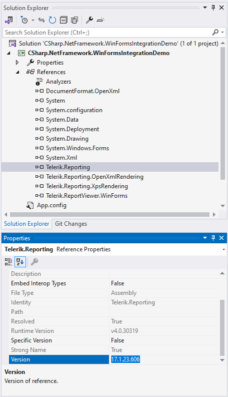
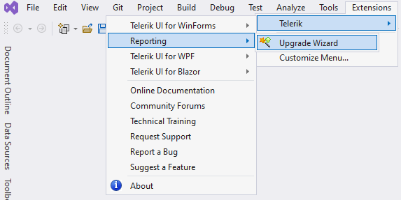
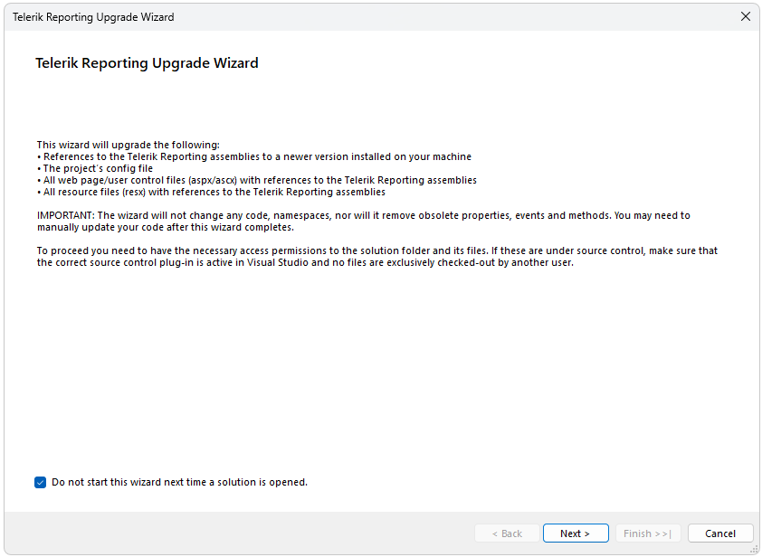
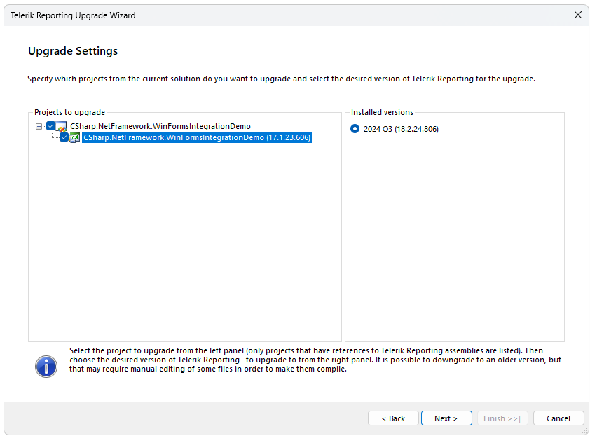
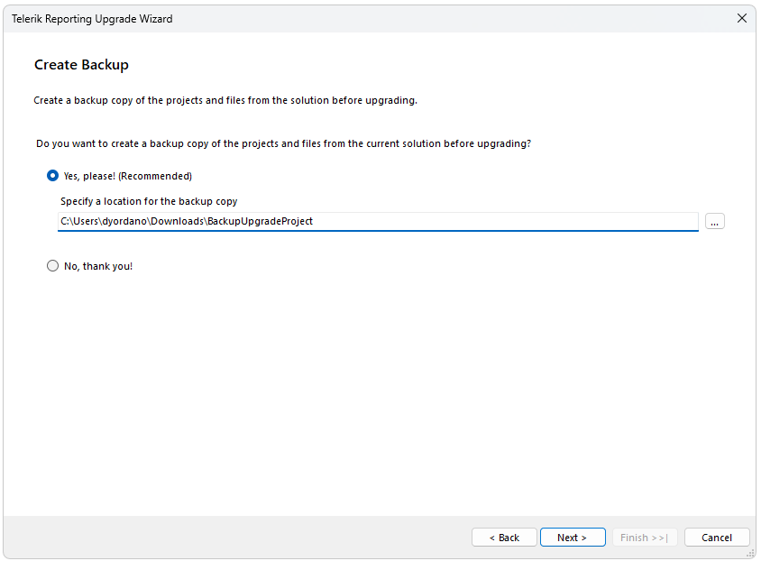
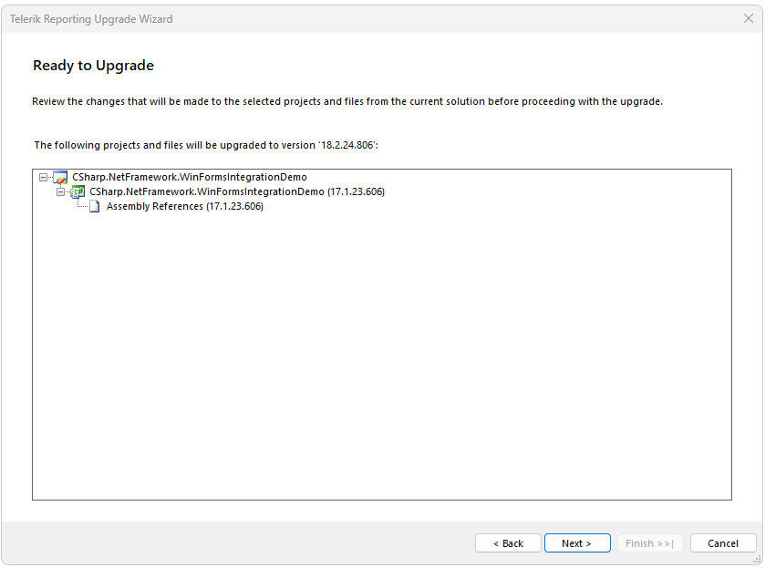
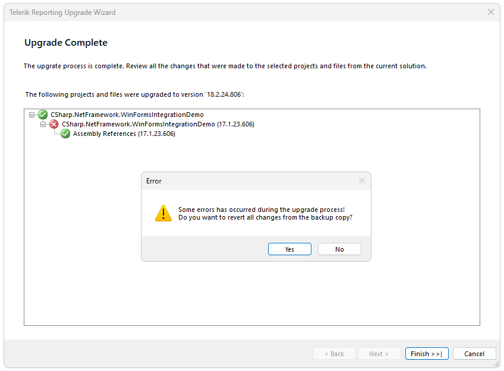
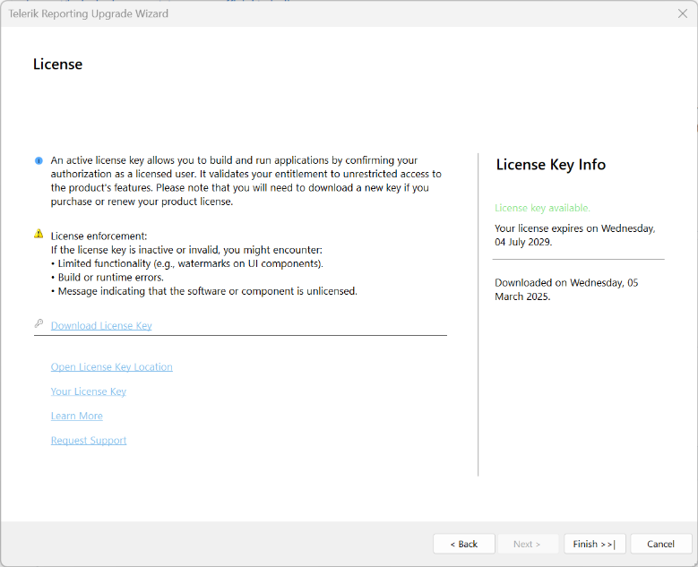
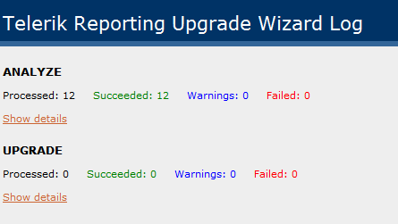
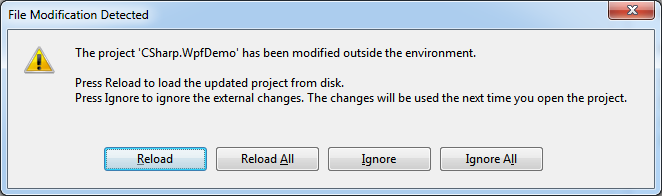

# Upgrade Wizard

The Visual Studio Extensions include the **Upgrade Wizard**, which guides you through upgrading or downgrading **Telerik Reporting** projects.

Before starting the wizard, check which Telerik Reporting version your project references:

Start the **Upgrade Wizard** from **Extensions** > **Telerik** > **Reporting** > **Upgrade Wizard**:

The wizard updates the following project items:

* References to Telerik Reporting assemblies
* The project `.config` file
* Web page and user control files (`aspx` and `ascx`) that reference Telerik Reporting assemblies
* Resource files (`resx`) that reference Telerik Reporting assemblies

>note The wizard does not change code or namespaces, and it does not remove obsolete properties, events, or methods. Update your code manually after the wizard completes.

>warning Web Site projects are not supported by the Upgrade Wizard. Upgrade these projects manually or convert them to Web Application projects. For more information, see [Web Application Projects versus Web Site Projects in Visual Studio](https://learn.microsoft.com/en-us/previous-versions/aspnet/dd547590(v=vs.110)).

The wizard also does not support the following project types:

>warning `.NET` and `.NET Core` projects are not supported by the Upgrade Wizard. Upgrade the following items manually:
>
> * References to Telerik Reporting assemblies or NuGet packages.
>
> * HTML5 Report Viewer scripts.

For the NuGet-based Visual Studio Report Designer for .NET, follow [Updating the Designer Package](slug:vs-report-designer-net-getting-started#updating-the-designer-package). Its version follows the project's `Telerik.Reporting.VSDesigner` package reference, and all Telerik Reporting packages must use that same version.

1. The first step provides basic information about the update process:

	

1. The next step lists all projects in the solution that use Telerik Reporting. Choose the projects to update and the target version. Upgrade all projects to the same version instead of updating only part of the solution.

	

1. The next step lets you create a project backup.

	

1. Review the changes before you continue.

	

1. The Complete step shows whether the wizard updated all projects successfully. If errors occur, choose whether to continue or revert the changes.

	

1. Starting with the [Progress® Telerik® Reporting 2025 Q2 (19.1.25.521)](https://www.telerik.com/support/whats-new/reporting/release-history/progress-telerik-reporting-2025-q2-19-1-25-521) release, the Licensing step lets you download a license key from your [Telerik account](https://www.telerik.com/account/) and save it in `%AppData%\Telerik`.

	

1. The final step shows a log file with the changes:

	

The Upgrade Wizard works only with project items. It is registered in Visual Studio and tracks Telerik Reporting installation folders on the machine. The wizard updates references with the selected version from that version's registered installation folder. If assemblies use a custom location, the wizard does not update that folder and points the references to the registered installation folder.

The wizard requires access to the solution folder and its files. If the solution or projects are under source control, activate the correct source control plug-in in Visual Studio and make sure no files are exclusively checked out by another user.

When you open a solution, the wizard checks the Telerik Reporting version. If a newer version is installed, Visual Studio can open the wizard automatically. To turn off this behavior, select **Do not start this wizard**. You can start it later from the [Telerik Reporting menu](slug:telerikreporting/designing-reports/report-designer-tools/desktop-designers/visual-studio-report-designer/telerik-reporting-menu) by choosing **Upgrade Wizard**.

Create a backup before you continue because the upgrade process is irreversible. After the wizard updates the files, review the results and reload the modified project when Visual Studio displays the **File Modification Detected** prompt.

## Handling Compilation Errors and Warnings

Run the **Upgrade Wizard** to upgrade your _ReportLibrary_ projects hosting reports created with the [Visual Studio Report Designer](slug:telerikreporting/designing-reports/report-designer-tools/desktop-designers/visual-studio-report-designer/overview).

The wizard does not change your code. As a result, compilation errors or warnings can occur for obsolete properties, methods, and events. Update your code manually. The [Telerik Reporting release notes](https://www.telerik.com/support/whats-new/reporting/release-history) list obsolete and deleted members and explain what to use instead. Review the release notes for each Telerik Reporting version from the version you upgraded from through the target version, including intermediate versions.

If you still experience problems after the upgrade, contact us through the [Telerik Reporting technical support ticketing system](https://www.telerik.com/account/support-center/contact-us/technical-support). Include your solution or project as a `.zip` file and provide the errors or warnings you see.

## See Also

* [Missing Telerik menu in Visual Studio](slug:missing-telerik-menu-in-visual-studio)
* [Updating the Visual Studio Report Designer for .NET](slug:vs-report-designer-net-getting-started#updating-the-designer-package)
