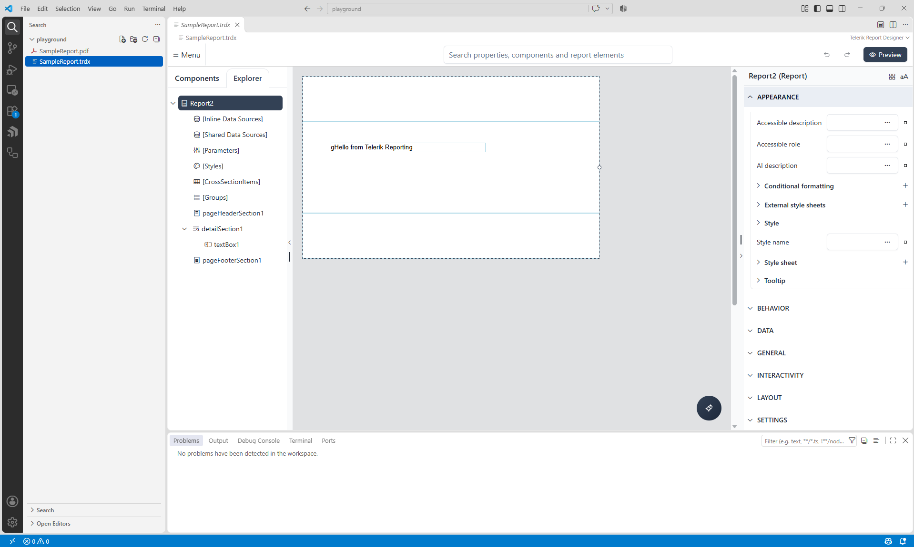

# Telerik Reporting in Visual Studio Code

The Telerik Reporting extension lets you create, edit, and preview reports directly in Visual Studio Code without first creating an application or installing Telerik Reporting through the Windows MSI installer. You can start with a new report or work with existing report definitions.

The extension opens the [Web Report Designer](slug:telerikreporting/designing-reports/report-designer-tools/web-report-designer/overview) in a VS Code editor and starts a local Reporting service for processing and previewing reports.

## Installing the Extension

Install [Telerik Reporting Productivity Tools](https://marketplace.visualstudio.com/items?itemName=TelerikInc.telerik-reporting-productivity-tools) from the Visual Studio Marketplace. You can also find the extension by name in the VS Code **Extensions** view and select **Install**.

Select **File** > **Open Folder** to open the folder that contains your report. Open only folders and reports you trust. The extension starts the local Reporting service automatically when you open a report, so design and preview do not require an application project.

## Running Extension Commands

The extension adds commands to VS Code's **Command Palette**. To run one, select **View** > **Command Palette**, enter the command name, and select it from the results. Search for `Telerik Reporting:` to find the extension's commands. These commands run inside VS Code, not in a terminal.

You can also open the **Command Palette** with `Ctrl`+`Shift`+`P` on Windows or Linux, or `Cmd`+`Shift`+`P` on macOS.

## Choosing a Workflow

Start with the guide that matches what you want to do:

| If you want to... | Start with |
|---|---|
| Create and preview your first report without a database or application project | [Getting Started with Reports in VS Code](slug:telerikreporting/designing-reports/report-designer-tools/working-with-reports-in-vs-code) |
| Open and modify reports from an existing application or repository | [Working with Existing Reports in VS Code](slug:telerikreporting/designing-reports/report-designer-tools/vscode-existing-reports) |

For named database connections, licensing, and common commands and settings, see [the VS Code configuration reference](slug:reporting-vs-code-configuration-and-reference).

For resources, custom user functions, or other application-level configuration, see [how to continue in a Web Report Designer application](slug:telerikreporting/designing-reports/report-designer-tools/vscode-existing-reports#resolving-report-dependencies).

## Licensing

You can design and preview reports before you configure a license. Without a valid license, exported report documents display a licensing watermark. To remove it, [set up an existing license or a free trial license](slug:reporting-vs-code-configuration-and-reference#configuring-a-license).

AI-assisted editing also requires a valid Telerik Reporting Subscription or Trial license and a language model available through VS Code. For setup and the editing workflow, see [Using AI with an Existing Report](slug:telerikreporting/designing-reports/report-designer-tools/vscode-existing-reports#using-ai-assisted-authoring).