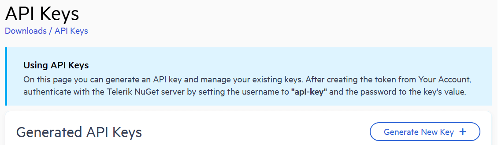
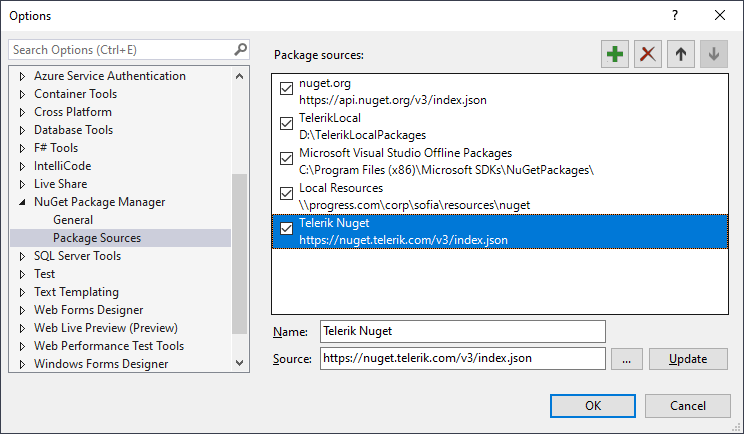
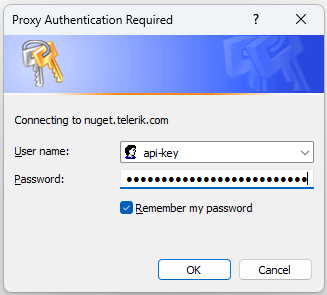
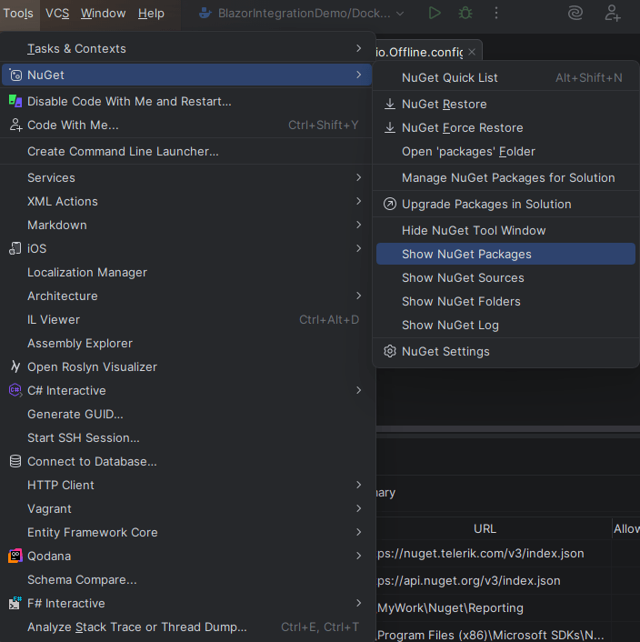
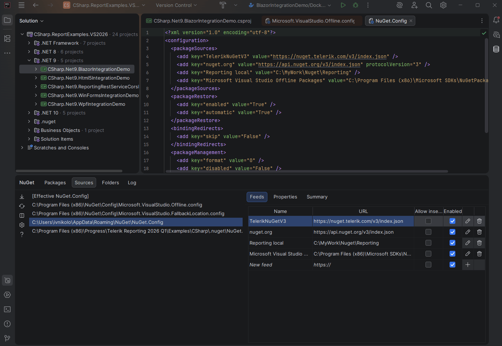

<style> img[alt$="><"] { border: 1px solid lightgrey; } </style>

# Install with NuGet Packages

This article explains how to install Telerik Reporting with NuGet packages, choose a package source, and authenticate with the Telerik private feed when required.

Use one of the following installation paths:

- [Install Telerik Reporting from NuGet.org](#installing-telerik-reporting-from-nuget-org)
- [Install Telerik Reporting from the Telerik NuGet server](#installing-from-the-telerik-nuget-server)
- [Install Telerik Reporting from a local NuGet feed](slug:setup-local-nuget-feed)

## Choosing the Right NuGet Installation Path

For current Telerik Reporting releases, use [NuGet.org](https://www.nuget.org/). NuGet.org is the default package source in Visual Studio and the .NET CLI.

Use a [local NuGet feed](slug:setup-local-nuget-feed) for offline installation, controlled networks, or mirrored package sources for build agents.

Use the **Telerik NuGet server** for older package versions or when your organization requires the Telerik private feed.

## Installing Telerik Reporting from NuGet.org

Starting with the **2026 Q3** release, Telerik Reporting packages are available on [NuGet.org package hosting](https://www.nuget.org/). This is the recommended source for new development.

### Installing from NuGet.org in Visual Studio

1. In Solution Explorer, right-click the project and select **Manage NuGet Packages...**.
2. In **Package source**, verify that **nuget.org** is selected.
3. On the **Browse** tab, search for the package you need, such as `Telerik.Reporting`.
4. Select the package and select **Install**.

### Installing from NuGet.org with the .NET CLI

Use the .NET CLI for repeatable setup steps in local development, containers, or automation scripts:

```bash
dotnet add package Telerik.Reporting
```

### Installing from NuGet.org with Package Manager Console

Use the Visual Studio Package Manager Console for PowerShell-based package commands:

```powershell
Install-Package Telerik.Reporting
```

## Installing from the Telerik NuGet Server

>important Starting with the **2026 Q3** release, NuGet.org is the recommended source for current Telerik Reporting packages. Use the Telerik NuGet server for older releases or when your organization requires the private feed.

The Telerik NuGet server provides authenticated access to Telerik packages.

Before you add the Telerik NuGet server, verify these prerequisites:

- Your Telerik account has access to Telerik Reporting.
- You can sign in to your Telerik account in a browser.
- You are ready to use an API key as the NuGet password.

### Generating an API Key

The Telerik NuGet server requires authentication. Use the API key instead of an account password when a NuGet client asks for credentials.

1. Go to the [API Keys](https://www.telerik.com/account/downloads/api-keys) page in your Telerik account.
2. Click **Generate New Key +**.

   

3. In the **Key Note** field, add a note that describes the API key. For **Key Type**, select `Nuget`.
4. Click **Generate Key**.
5. Select **Copy and Close**. You cannot copy the key after closing the window.
6. Store the generated key. Use `api-key` as the username and the generated key as the password.

>important API keys expire after two years. Track where you used each key so you can replace it before it expires.

### Setting Up in Visual Studio

Use this method to install Telerik Reporting packages through the Visual Studio NuGet Package Manager.

1. Open Visual Studio.
2. Go to **Tools** > **NuGet Package Manager** > **Package Manager Settings**.
3. Select **Package Sources** and click **+**.
4. Enter a feed name such as **Telerik**.
5. Set the feed URL to `https://nuget.telerik.com/v3/index.json` and click **OK**.

   >caption The Visual Studio NuGet Package Manager and the Telerik NuGet feed

   

6. Create or load your project.
7. Go to **Tools** > **NuGet Package Manager** > **Manage NuGet Packages for Solution**.
8. In the upper-right corner, select the Telerik **Package source**.
9. Click the **Browse** tab to see the available packages.
10. If a credentials dialog appears, enter `api-key` in **User name** and the [generated API key](#generating-an-api-key) in **Password**.

   >caption Credential prompt for the Telerik NuGet feed in Visual Studio

   

After you authenticate, the Telerik packages available to your account appear in the package list.

### Handling a Missing Sign-In Dialog in Visual Studio

Some environments do not show a credentials dialog automatically. Use these checks and fallback options:

1. Select the Telerik package source and click **Browse**. Visual Studio can request credentials when it first queries the feed.
2. If no dialog appears, close the package manager, reopen it, and select the Telerik source again.
3. If the feed still shows no packages, use the .NET CLI method in [Setting Up with the NuGet CLI](#setting-up-with-the-nuget-cli).
4. If cached credentials are incorrect or expired, update the Telerik source credentials with the command in the next section.

### Setting Up with the NuGet CLI

Use the .NET CLI in Visual Studio Code, on Linux or macOS, in CI environments, or when Visual Studio does not show a credentials dialog.

1. Add the Telerik source with the .NET CLI. Replace `<API_KEY>` with the [generated API key](#generating-an-api-key):

   ```bash
   dotnet nuget add source "https://nuget.telerik.com/v3/index.json" --name "telerik.com" --username "api-key" --password "<API_KEY>" --store-password-in-clear-text
   ```

   >warning The `--store-password-in-clear-text` option saves the API key as plain text in `NuGet.Config`. Protect the file and do not commit it to source control.

2. To update expired or invalid credentials, run the following command and replace `<API_KEY>` with the new key:

   ```bash
   dotnet nuget update source "telerik.com" --source "https://nuget.telerik.com/v3/index.json" --username "api-key" --password "<API_KEY>" --store-password-in-clear-text
   ```

3. To use the Windows-specific NuGet CLI client instead, download the [latest Windows NuGet CLI executable (`nuget.exe`)](https://dist.nuget.org/win-x86-commandline/latest/nuget.exe).

After you run a command, reopen Visual Studio, Rider, or another NuGet client so it reloads the updated source configuration.

### Setting Up in JetBrains Rider

Use this method to install packages through JetBrains Rider.

1. Open JetBrains Rider.
2. From the main menu, select **Tools** > **NuGet** > **NuGet Quick List**, or press `Alt`+`Shift`+`N`.
3. Choose **Show NuGet Packages**.

   

4. At the top of the NuGet tool window, switch to the **Sources** tab.
5. In the left panel, select a specific `NuGet.Config` file, such as `C:\Users\username\AppData\Roaming\NuGet\NuGet.Config`.
6. After you select a file, the **Feeds** list appears on the right.
7. Add, edit, enable, or disable package sources as needed.

   

If Rider does not prompt for credentials, configure the feed with the .NET CLI and reopen Rider.

### Resetting Stored Credentials

If you previously stored credentials for the Telerik NuGet server, reset them before you authenticate with a new API key:

1. Remove saved credentials in the [Windows Credential Manager](https://support.microsoft.com/en-us/windows/accessing-credential-manager-1b5c916a-6a16-889f-8581-fc16e8165ac0). The credentials appear as `nuget.telerik.com` or `VSCredentials_nuget.telerik.com`.
2. Remove the Telerik NuGet package source from Visual Studio.
3. If you added the source with the .NET CLI, use [`dotnet nuget list source`](https://learn.microsoft.com/en-us/dotnet/core/tools/dotnet-nuget-list-source) and [`dotnet nuget remove source`](https://learn.microsoft.com/en-us/dotnet/core/tools/dotnet-nuget-remove-source).
4. Check `%AppData%\NuGet\Nuget.Config` for stored credentials and remove them. Use the following example as a reference:

   {{source=CodeSnippets\Blazor\Docs\XML\NugetConfig.xml}}

5. [Force NuGet to ask for authentication](https://stackoverflow.com/questions/43550797/how-to-force-nuget-to-ask-for-authentication-when-connecting-to-a-private-feed).
6. Restart Visual Studio.
7. Add the Telerik NuGet package source again through Visual Studio or the .NET CLI.

### Verifying the Feed Setup

After you add and authenticate the feed, confirm that:

- The Telerik feed appears in your NuGet package sources.
- Telerik Reporting packages are visible when you browse the Telerik source.
- Package installation succeeds without repeated authentication failures.
- The Telerik source uses the expected URL in `NuGet.Config`.

### Troubleshooting Common Problems

Use these checks when the feed does not work:

- If no sign-in dialog appears, use the CLI method to add or update the Telerik source credentials.
- If you see no Telerik packages, confirm that the Telerik source is selected and the account behind the API key has Telerik Reporting access.
- If authentication fails, generate a new API key and update the stored credentials.
- If the feed worked earlier and stopped working, check whether the API key expired.
- If a corporate network blocks package restore, verify that the system can reach `https://nuget.telerik.com/v3/index.json`.
- If NuGet returns a 401 error, follow the [NuGet 401 error troubleshooting steps](slug:nuget-feed-returned-unexpected-401-status-error).

## See Also

- [Restoring NuGet Packages in Your CI Workflow](slug:restoring-nugets-in-ci)
- [NuGet V2 Feed Error about Returned Unexpected 401 Status Code](slug:nuget-feed-returned-unexpected-401-status-error)
- [Setup a Local NuGet Package Feed](slug:setup-local-nuget-feed)
