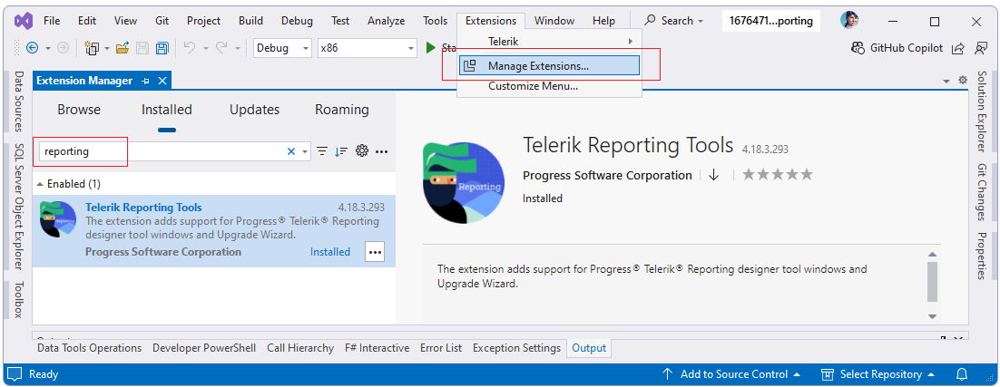
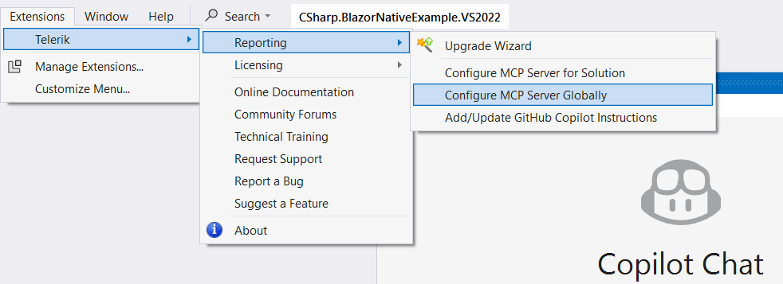
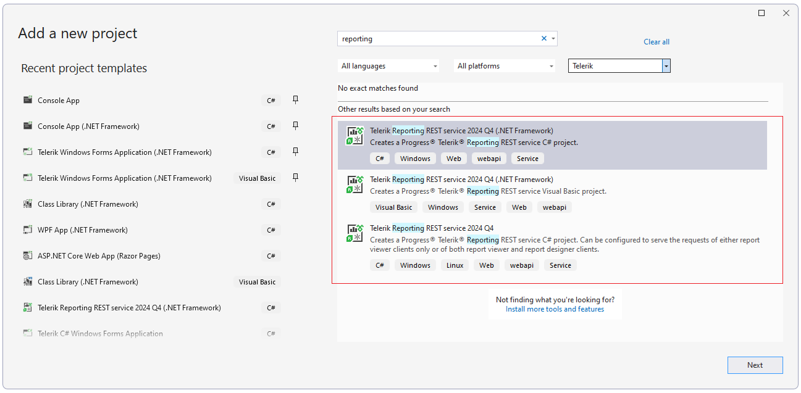
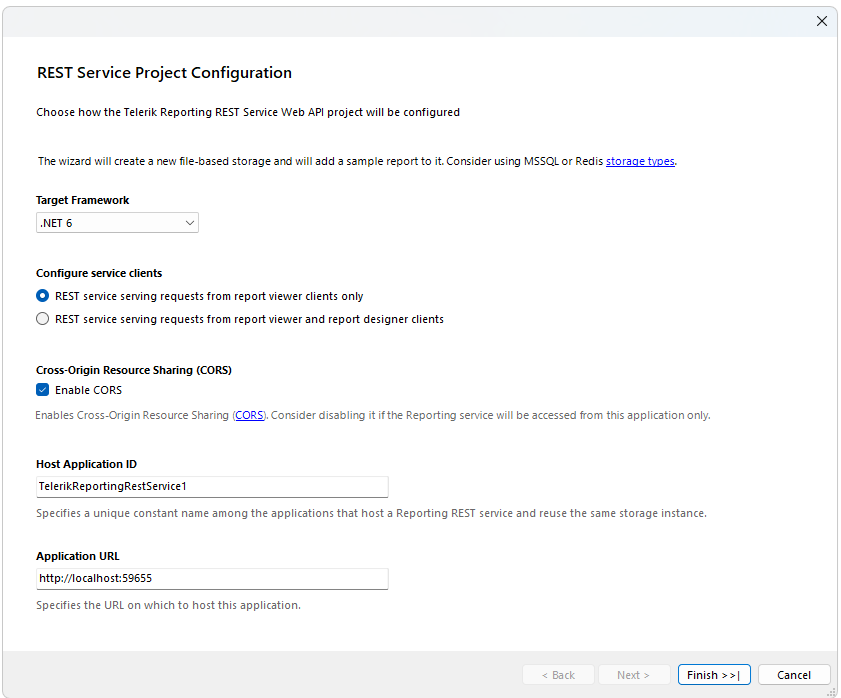
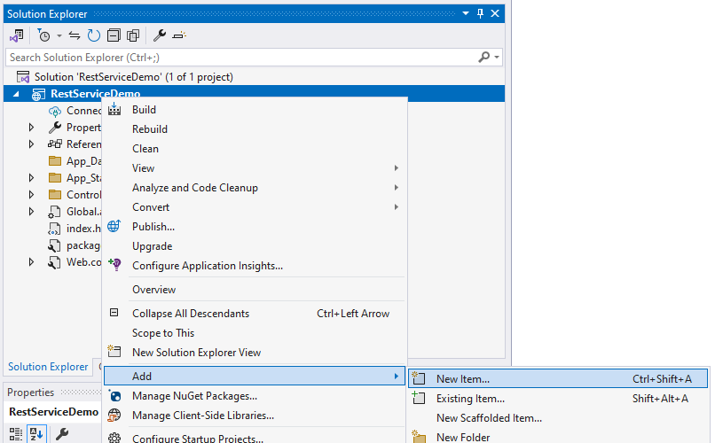
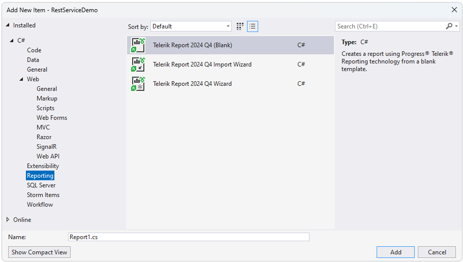
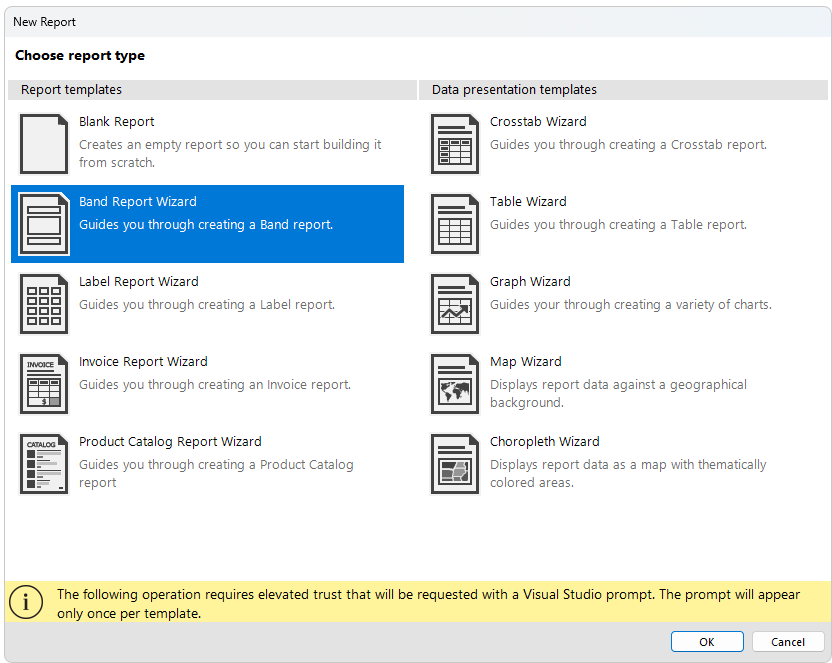
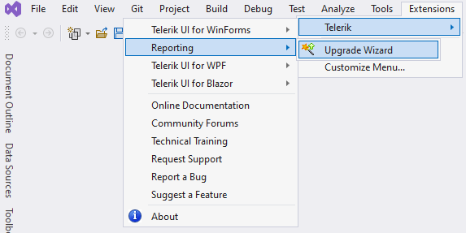
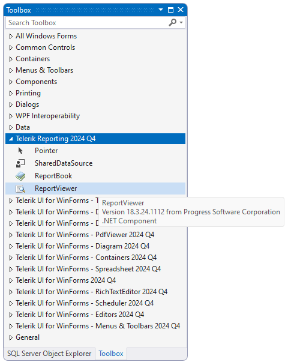

# Integration with Visual Studio

The Telerik Reporting Visual Studio extensions help you configure AI tooling. They also let you create Telerik Reporting projects and report items, and upgrade or downgrade existing .NET Framework projects from Visual Studio.

After you install Telerik Reporting, use **Extensions > Telerik > Reporting** to access the extension commands.

To verify that the extension is installed, open **Extensions > Telerik > Manage Extensions**, select **Installed**, and search for `reporting`:

## What the Extensions Add

The Visual Studio extensions support the following development tasks:

- Configure the Telerik Reporting MCP Server globally or per solution.
- Add GitHub Copilot repository instructions for Telerik Reporting projects.
- Create new Telerik Reporting project types.
- Add new report items and launch report wizards.
- Upgrade or downgrade Telerik Reporting versions in .NET Framework projects.

## Configuring the Telerik Reporting MCP Server

Starting with the [Progress® Telerik® Reporting 2025 Q4 (19.3.25.1111)](https://www.telerik.com/support/whats-new/reporting/release-history/progress-telerik-reporting-2025-q4-19-3-25-1111) release, you can set up the [Telerik Reporting MCP Server](slug:ai-mcp-server) through the Telerik Reporting Visual Studio extension.

Use this integration to let GitHub Copilot or another Model Context Protocol (MCP)-compatible client access Telerik Reporting context from your development environment.

### Choosing the Configuration Scope

The extension provides the following MCP-related commands:

- The `Configure MCP Server Globally` option creates or updates the global `%USERPROFILE%\.mcp.json` file and adds the Telerik server entry.
- The `Configure MCP Server for Solution` option appears when a project is open in Visual Studio. It creates or updates the `.mcp.json` file in the solution directory.
- The `Add/Update GitHub Copilot Instructions` option appears when a project is open in Visual Studio. It creates or updates the [copilot-instructions.md](https://docs.github.com/en/copilot/how-tos/configure-custom-instructions/add-repository-instructions?tool=visualstudio) file in the solution's `.github` folder (`SolutionDir\.github\copilot-instructions.md`). The file provides extra context to Copilot Chat in Visual Studio.

Choose the global option to make the Telerik Reporting MCP Server available across multiple repositories. Choose the solution option to store the configuration with a specific solution.

### Setting Up the MCP Server

To configure the MCP server from Visual Studio:

1. Open Visual Studio.
1. Open **Extensions > Telerik > Reporting**.
1. Select **Configure MCP Server Globally** or **Configure MCP Server for Solution**.
1. If you are working in a solution and want GitHub Copilot to receive Telerik Reporting-specific repository instructions, select **Add/Update GitHub Copilot Instructions**.
1. Verify that the expected configuration file was created or updated.

After this setup, your MCP client can use the Telerik Reporting MCP Server configuration that the extension generated.
If you use GitHub Copilot, restart Visual Studio and enable the `telerik-reporting-assistant` tool in Copilot Chat.

## Project Templates

After [installing Telerik Reporting](slug:telerikreporting/installation), the extensions add Telerik Reporting project templates to the **New Project** dialog in Visual Studio:

Use these templates when you want to start with a project that already contains the basic Telerik Reporting setup.

### Creating a Telerik Reporting Project

To create a project from a Telerik Reporting template:

1. In Visual Studio, select **File > New > Project**.
1. Search for Telerik Reporting templates or filter the list until the Telerik Reporting templates appear.
1. Select the template that matches your scenario.
1. Complete the standard Visual Studio project creation steps.

### Configuring a REST Service Project

If you select **Telerik Reporting REST service**, the **REST Service Project Configuration** wizard opens:

Use that wizard to configure the REST service properties for your project.

For hosting guidance after the project is created, refer to:

- [Host the Telerik Reporting REST Service in an ASP.NET Application](slug:telerikreporting/using-reports-in-applications/host-the-report-engine-remotely/telerik-reporting-rest-services/asp.net-web-api-implementation/how-to-add-telerik-reporting-rest-web-api-to-web-application)
- [Host the Telerik Reporting REST Service in ASP.NET Core with Minimal API](slug:how-to-host-reports-service-in-aspnet-core-in-net-6-with-minimal-api)

## Item Templates and Report Wizards

When you install [Telerik Reporting](slug:telerikreporting/installation), several [report item](slug:report_item) templates are added to the **New Item** dialog of Visual Studio:

The **New Item** dialog lists the available Telerik Reporting item templates:

### Adding a New Reporting Item

To add a Telerik Reporting item to an existing project:

1. In **Solution Explorer**, right-click the target project.
1. Select **Add > New Item**.
1. Select the Telerik Reporting item template that matches your scenario.
1. Finish the item creation flow.

### Launching Report Wizards

If you choose a wizard-based report template, the **New Report Wizard** opens:

Depending on your selection, the corresponding report wizard is displayed, for example, the [Band Report Wizard](slug:telerikreporting/designing-reports/report-designer-tools/desktop-designers/tools/report-wizards/band-report-wizard/overview).

## Using the Upgrade Wizard

The [Upgrade Wizard](slug:telerikreporting/designing-reports/report-designer-tools/desktop-designers/visual-studio-report-designer/upgrade-wizard) lets you upgrade or downgrade a .NET Framework project to any installed Telerik Reporting version.

To start the wizard, select **Extensions > Telerik > Reporting > Upgrade Wizard**:

Use the Upgrade Wizard when you need to align an existing .NET Framework project with a different installed Telerik Reporting version.

## Using the Visual Studio Report Designer and Toolbox

After [installing Telerik Reporting](slug:telerikreporting/installation), you can use the [Visual Studio Report Designer](slug:telerikreporting/designing-reports/report-designer-tools/desktop-designers/visual-studio-report-designer/overview) in a .NET Framework project to create new reports and import reports from other formats.

During the [installation process](slug:telerikreporting/installation), Telerik Reporting assemblies are also added to the Global Assembly Cache (GAC). This enables the corresponding items in the Visual Studio Toolbox for .NET Framework projects:

If the Telerik Reporting Toolbox items do not appear, refer to the [troubleshooting article for missing Telerik Reporting Toolbox items](slug:telerik-reporting-toolbox-items-are-missing).

## See Also

- [Telerik Reporting MCP Server](slug:ai-mcp-server)
- [Upgrade Wizard](slug:telerikreporting/designing-reports/report-designer-tools/desktop-designers/visual-studio-report-designer/upgrade-wizard)
- [Visual Studio Report Designer](slug:telerikreporting/designing-reports/report-designer-tools/desktop-designers/visual-studio-report-designer/overview)
- [Troubleshooting Visual Studio Report Designer Problems](slug:telerikreporting/designing-reports/report-designer-tools/desktop-designers/visual-studio-report-designer/visual-studio-problems)
- [Installation Approaches for Telerik Reporting](slug:telerikreporting/installation)
