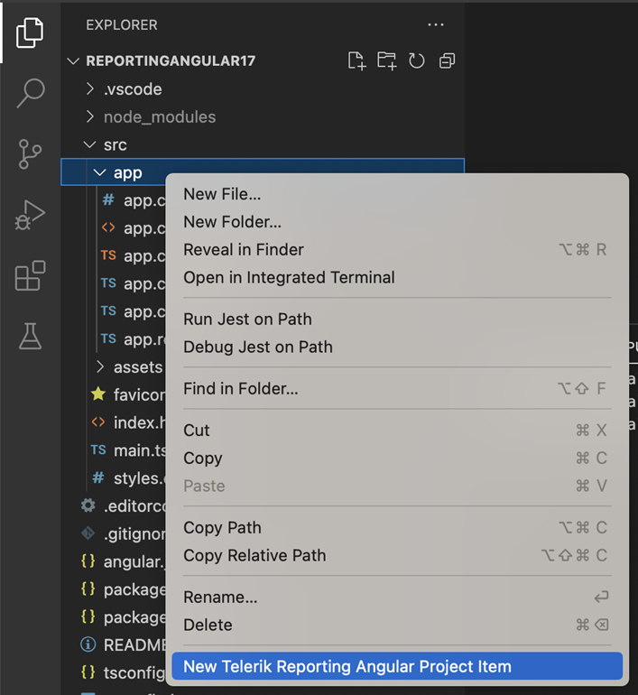
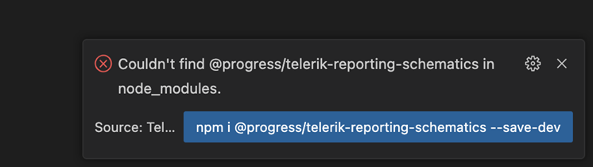
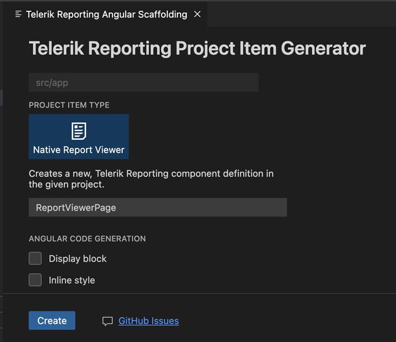
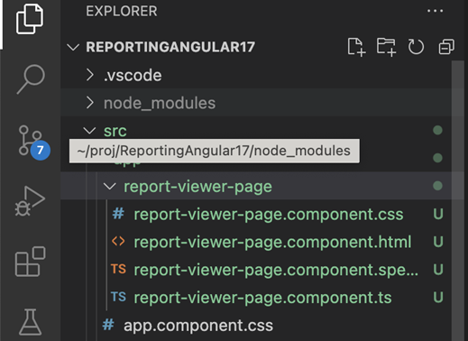

# Integration with VS Code

The Telerik Reporting extension supports two related but different tasks in Visual Studio Code: authoring report definitions and creating application projects that use Telerik Reporting. You can design and preview reports without an application project.

## Designing Reports in VS Code

If you want to create or edit report definitions, start with [Telerik Reporting in Visual Studio Code](slug:telerikreporting/designing-reports/report-designer-tools/vscode). This article focuses on the application workflows: generating a standalone Web Report Designer application or adding the Native Angular Report Viewer to an Angular application.

## Preparing VS Code

Open a trusted file-system folder before you run an extension command. The extension starts its bundled local Reporting service when you open a report. Because preview can access local files and run data-source queries, only open reports from sources you trust. The extension does not activate in untrusted or virtual workspaces.

The application workflows have different prerequisites:

* Generating a standalone Web Report Designer application requires the .NET 10 SDK and access to the Telerik NuGet feed.
* Adding the Native Angular Report Viewer requires a supported Angular project and a Reporting REST service.

For local report design, data connections, or AI-assisted authoring, see [Telerik Reporting in Visual Studio Code](slug:telerikreporting/designing-reports/report-designer-tools/vscode) and choose the matching guide.

To run an extension command, open the **Command Palette** with `Ctrl`+`Shift`+`P` on Windows or Linux, or `Cmd`+`Shift`+`P` on macOS. Search for `Telerik Reporting:` and select the command.

## Creating a Web Report Designer Application

You do not need an application to design or preview reports in VS Code. Generate a standalone app when you want to customize its host, keep application code in its own project, or run the Web Report Designer independently. **Telerik Reporting: Create Project** generates an ASP.NET Core application with a designer page and built-in preview.

The command is optional; the extension can create and preview reports without it. It creates a separate .NET 10 project from the Web Report Designer template, not a viewer inside an existing application. Building it requires the .NET 10 SDK and access to the Telerik NuGet feed.

For example, to bring the getting-started report into a new application:

1. Save `HelloReporting.trdx` in the designer. The generator copies report files from disk, not pending designer edits.
2. Open the **Command Palette** and run **Telerik Reporting: Create Project**.
3. If the report selection appears, select `HelloReporting.trdx`. Leave the selection empty to use a sample report instead.
4. Enter `MyReportingApp` as the project name.
5. Choose the parent folder. The command creates `MyReportingApp` inside it. The target folder must be empty or not exist.
6. Wait for the build check. On success, select **Open Folder** to open the generated project in a new VS Code window.

Selected reports appear in the generated project's `Reports` folder. The first selected report becomes the page's default report. If you select no reports, the project contains `SampleReport.trdp` instead.

The generator also copies files from the reports' shared-data-source and resource folders into `Reports/Shared Data Sources` and `Reports/Resources`. It does not copy your VS Code settings or Reporting configuration file. Configure connection strings and licensing for the generated application separately.

From a terminal in `MyReportingApp`, start the application:

```bash
dotnet run
```

Open the localhost URL shown in the terminal to use the Web Report Designer in a browser. The address can vary with the generated project's launch settings. This application runs independently of the extension's local Reporting service.

If the build check fails, the generated files remain in the target folder. Select **Show Logs** to inspect the cause. Correct the SDK or NuGet access issue, then run `dotnet build` in the generated project; you do not need to generate it again.

## Adding the Native Angular Report Viewer

Use this generator when you want a report-viewing page inside an Angular application. It adds the Native Angular Report Viewer component. The viewer requests report documents from a Telerik Reporting REST service. You can host the service in the same solution or separately. The project item generator does not create the service or a Web Report Designer.

If you already have an Angular application, open its folder in VS Code. To create a new application for this workflow, run Angular CLI:

```bash
ng new ReportingAngularApp
```

Open the new application folder in a trusted VS Code workspace before you use the project item generator.

> note The Telerik CLI also includes a complete-app template for the Native Angular Report Viewer. See the [Telerik CLI article](slug:reporting-telerik-cli) for details.

To add the report viewer to your Angular application:

1. In the VS Code Explorer, right-click the target folder and select **New Telerik Reporting Angular Project Item**:

	

2. If VS Code reports that `@progress/telerik-reporting-schematics` is missing, select **npm i ...** in the prompt:

	

3. In the scaffolding wizard, select the Angular component options:

	

4. Select **Create** to generate an Angular component with a configured Native Angular Report Viewer:

	

5. Add the new component to your routing or to the HTML of an existing component.

## See Also

Continue with the documentation for the workflow you selected:

* [Telerik Reporting in Visual Studio Code](slug:telerikreporting/designing-reports/report-designer-tools/vscode)
* [VS Code Configuration and Reference](slug:reporting-vs-code-configuration-and-reference)
* [Adding the Native Angular Report Viewer with the Project Item Generator](slug:telerikreporting/using-reports-in-applications/display-reports-in-applications/web-application/native-angular-report-viewer/integrating-with-project-item-generator)
