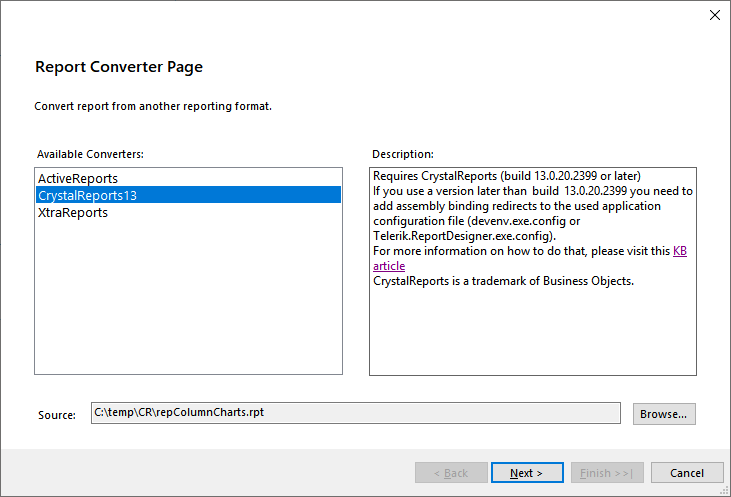

---
title: SAP Crystal Reports
page_title: Converting reports created with SAP Crystal Reports
description: "Learn how to convert an existing report, created with the 'SAP Crystal Reports' reporting solution, into a 'Telerik Reporting' report definition."
slug: telerikreporting/designing-reports/converting-reports-from-other-reporting-solutions/crystal-reports-converter
tags: telerik, reporting, importing, reports, crystal, reports, converter
published: True
position: 1
previous_url: /crystal-reports-converter
reportingArea: General
components: [general]
---

<style>
table {
	width: 100%;
	table-layout: fixed;
}

table th:first-of-type {
	width: 20%;
}
</style>

# Converting SAP Crystal Reports

This article explains how to convert a report created with SAP Crystal Reports to a Telerik Reporting report definition.

## Prerequisites

The Crystal Reports runtime should be installed on the machine.

## Changes Information

>note The Crystal Reports converter includes significant improvements in Telerik Reporting 2026 Q4 (20.3.26.1111). Some functionality described in this article is not available in earlier versions.

The latest Telerik Crystal Reports Converter is built against Crystal Reports 13.0.20.2399. It offers an improved conversion process, supports more report items, and provides a better user experience. It is actively developed and extended to cover more user scenarios.

Converting a Crystal Reports definition with a version lower than 13.0.2000 is not supported. We strongly recommend first upgrading such older Crystal Reports definitions to a supported version and then utilizing the latest Crystal Reports converter. If this is not an option, you can try an older converter available in Telerik Reporting R3 2019 or earlier versions. Note that this would result in a conversion with lower quality. More info is available in this KB article: [Converting reports from various versions of CrystalReports](slug:converting-reports-from-various-versions-of-crystalreports).

The Report Converter page lists the installed converters and the source report path:



## Conversion Process

The converter maps supported Crystal Reports objects and properties to Telerik Reporting report items. The following table summarizes the supported conversions:

| Report element | Supported conversion |
| --- | --- |
| Report structure | The converter maps headers, footers, details, and group sections to corresponding Telerik sections. Multiple Crystal sections in an area become separate panels. Static suppression, supported conditional suppression formulas, supported page breaks, keep-together settings, and repeating group headers are mapped. |
| Data connections | OLE DB and ODBC connections are supported. Recognized DAO/Access connections with a valid MDB or ACCDB path can map to ACE OLE DB. Supported linked tables on compatible SQL Server or Access connections can become a combined query. |
| Report parameters | The converter handles command and report parameters. It normalizes report parameter names and references to unique valid identifiers, and maps prompt text, current selections, multi-value parameters, range parameters split into lower- and upper-bound parameters, and static discrete choices with labels. |
| Field objects | Supported database, formula, and parameter references become `TextBox` expressions. The converter maps supported conditional styles, Highlighting Expert rules, display-string formulas, and number, date, and currency formats. Supported HTML-interpreted fields can become `HtmlTextBox` items. |
| Text objects | Text boxes can contain static text, converted embedded fields, and expressions. Supported paragraph breaks and embedded-value formats are retained. |
| Summary fields | The converter maps `Sum`, `Count`, `Distinct Count`, `Minimum`, `Maximum`, and `Average`, as well as sample and population standard deviation and variance. Supported `PercentOfSum` and `PercentOfCount` summaries and selected running-total scenarios also have conversion paths. |
| Cross-tab objects | The converter reads the cross-tab definition and reconstructs supported row and column groups, multiple measures, subtotals, grand totals, formatting, grid colors, and grand-total suppression. Supported date intervals and corner-picture ownership are also handled. |
| Subreport objects | The converter converts child reports, writes external `.trdp` files, and assigns a `UriReportSource`. The converter maps supported scalar parameter links and child selections. |
| Line and box objects | Lines and boxes become `Shape` items. Supported cross-section segments, diagonal directions, fills, and rounded or elliptical box shapes are also converted. |
| Picture box objects | Supported embedded images and database-bound images are converted. The converter applies supported cropping and stores embedded image data in the target definition. |
| Chart objects | Charts become `Graph` items. Supported chart types include horizontal bars, bubble, and numeric charts, plus clustered, stacked, and 100-percent-stacked variants. The converter also maps supported titles, legends, labels, axes, and filtering and group-scope settings. |
| Barcode objects | Recognized font patterns map to Code 39, Code 128, EAN-13, EAN-8, UPC-A, UPC-E, Interleaved 2 of 5, QR Code, PDF417, and Data Matrix encoders. |
| Special fields | Supported mappings include report title, comments, author, source filename, and file creation date when available. Record numbering and page-field placement account for supported report and group scopes. |

## Additional Conversion Details

The converter also maps report logic and navigation in supported scenarios:

| Capability | Supported conversion |
| --- | --- |
| Formula conversion | The converter translates supported Crystal formulas into Telerik Reporting expressions. Supported constructs include field and parameter references, arithmetic, comparisons, conditional expressions, and selected string, numeric, date, and custom functions. Review conversion messages for unsupported or approximate expressions. |
| Record and group selection | Supported record-selection formulas become report filters, which generally run after data retrieval. Supported group-selection formulas become group filters. Group selection requires one converted group and one source table. Combinations with Top/Bottom N require manual review. |
| Grouping and sorting | Supported field- and formula-based groups, record sorting, group-summary sorting, date intervals, specified-order groups, and Top/Bottom N settings are mapped. Selected Access query scenarios preserve “Others” grouping and exact group counts. |
| Interactivity | Supported website and email hyperlinks, tooltip text and formulas, and selected report-navigation actions are mapped. Static links to Crystal reports become navigation targets for separately converted reports. Supported drill-down sections expand in place. |

## Conversion Limitations

Conversion does not guarantee identical output or behavior. Review all conversion messages and compare the converted report with the Crystal report. Check selected records, parameter values, totals, pagination, appearance, and navigation.

The following limitations require manual review or configuration:

| Area | Limitations |
| --- | --- |
| Layout and sections | Exact pagination and appearance are not guaranteed. Suppress-blank settings, conditional page options, printer settings, and some underlay or cross-section layouts require manual adjustment. |
| Data connections | Unsupported providers require manual setup. Automatic joins cover supported SQL Server and Access scenarios, not arbitrary connections or query structures. DAO-to-ACE mapping requires a valid database path and a compatible, matching-bitness ACE driver. |
| Parameters | Dynamic and cascading choice lists, edit masks, minimum and maximum constraints, maximum string lengths, and some date and time choices require manual configuration. Simple ranges retain only the first saved range, and converted range parameters do not reproduce the Crystal parameter interface. |
| Formulas | The converter does not support all Crystal or Basic syntax. General shared or global state, unsupported functions, SQL expression references, and evaluation-order-dependent logic require manual conversion. Only selected custom-function patterns are supported. |
| Fields and formatting | Only numeric greater-than Highlighting Expert rules that change font color without other style changes are converted. Review unsupported conditional formatting and format formulas manually. |
| Record and group selection | Saved-data selection is not converted. Record filters generally run after data retrieval and can increase the volume of retrieved data. Group selection requires one converted group and one source table. Review combinations with Top/Bottom N and independently bound data items. |
| Grouping and sorting | Some date intervals, dynamic sort and count formulas, hierarchical grouping, ties, and "Others" groups are unsupported or approximate. Exact Top/Bottom N membership is preserved only in selected scenarios. |
| Summaries and running totals | Median, mode, percentile, correlation, covariance, weighted average, and other unsupported aggregates require manual conversion. Running-total support depends on the operation, placement, evaluation condition, and reset scope. Some cases are approximated with warnings. |
| Cross-tabs | Empty-row and empty-column suppression and some automatic date captions are not reproduced. Unsupported structures or unavailable metadata can produce a default cross-tab instead of the original structure. |
| Subreports | Unsupported, duplicate, range, or multi-value parameter links require manual configuration. Keep generated child report files with the converted report. On-demand subreports remain inline rather than loading only after a click. |
| Text and formatting | Mixed font runs, general RTF interpretation, some HTML markup, paragraph spacing, and formatting formulas are not reproduced exactly. |
| Pictures | External and formula-based graphic locations are not activated. Some image formats and crop settings require manual replacement or adjustment. |
| Charts | Not all chart types are supported. Three-dimensional charts become two-dimensional charts. Radar charts become Cartesian line approximations, and multiple pies can be combined. Review some date grouping, cross-tab or OLAP bindings, labels, and axis options. |
| Barcodes | Recognized fonts select an encoder, but the converter does not generally decode vendor-encoded data. Verify raw payloads, checksums, and scanned results. |
| Interactivity | Crystal’s separate drill-down view is not reproduced; supported drill-down sections expand in place. Report-part links and unsupported interaction formulas require manual setup. Convert and deploy linked reports separately. |
| Special fields | Some timestamps use execution time or captured source metadata instead of Crystal semantics. Page fields require a supported page context. Unsupported child-report page information can remain a placeholder. |

## Configuring the Report Designer to Use the Converter

To load the Crystal Reports assemblies needed for the conversion, proper binding redirects need to be added to the configuration file of the report designer application. When using the Standalone Report Designer, this file is _Telerik.ReportDesigner.exe.config_, placed in the _\Report Designer_ subfolder of the product installation category. When using the Visual Studio Report Designer, this file is _devenv.exe.config_, placed in the _\Common7\Ide_ subfolder of the Visual Studio installation directory. The binding redirects need to point to the version of the Crystal Reports runtime installed on the machine.

The Crystal Reports assemblies are stored in the machine’s GAC (Global Assembly Cache). The GAC folder for .NET Framework v.4.0 and later is _%windir%\Microsoft.NET\assembly_, and for earlier versions is _%windir%\assembly_. Search the GAC for assemblies named _CrystalDecisions.Shared.dll_ or _CrystalDecisions.CrystalReports.Engine.dll_. The assembly version can be obtained either from the assembly subfolder name, or by using the [gacutil.exe](https://learn.microsoft.com/en-us/dotnet/framework/tools/gacutil-exe-gac-tool):

```TEXT
C:\WINDOWS\system32>gacutil -l CrystalDecisions.Shared
Microsoft (R).NET Global Assembly Cache Utility. Version 4.0.30319.0
Copyright (c) Microsoft Corporation. All rights reserved.
The Global Assembly Cache contains the following assemblies:
	CrystalDecisions.Shared, Version=13.0.3500.0, Culture=neutral, PublicKeyToken=692fbea5521e1304, processorArchitecture=MSIL
```

The output from the _gacutil.exe_ above shows that the current version of the installed Crystal Reports runtime assemblies is **13.0.3500.0**. Here is what the configuration file with added binding redirects will look like:

{{source=CodeSnippets\MvcCS\XmlConfiguration\CrystalReportsConfiguration.xml region=CrystalReportsConfiguration}}
During the conversion process, the engine outputs warnings and information messages for the converted items in the Summary page. After reviewing the messages, the produced report can be edited further to achieve the desired functionality.

## See Also

[Crystal Reports Product Matrix](https://wiki.scn.sap.com/wiki/display/BOBJ/Crystal+Reports+v.+9.1+to+SAP+Crystal+Reports+2013%2C+Runtime+Distribution+and+Supported+Operating+Systems)
