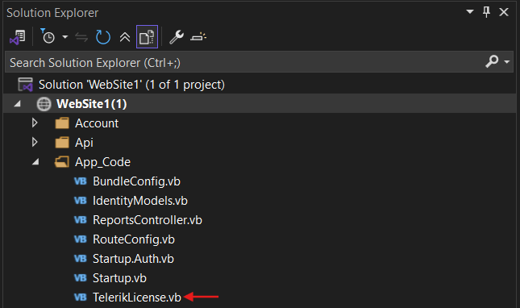

## Environment

The issue applies to the following environment:

| Property | Value |
|---|---|
| Area | Licensing |
| Version | 19.0.25.211+ |

## Description

An older ASP.NET Website project that uses Telerik Reporting to generate reports can display an invalid license watermark. This can happen despite following the licensing documentation, downloading the license key, using NuGet packages, and adding VB.NET script files.

Other Telerik controls, such as grids, work without issues. The Reporting Upgrade Wizard completes without errors, and all files in the `bin` directory update to the latest versions.

## Solution

To resolve the invalid license watermark issue:

1. In the Website project, add a reference to the `Telerik.Licensing.Runtime.dll` assembly. Find a copy in the `Bin` subfolder of the Telerik Reporting installation directory, for example, `C:\Program Files (x86)\Progress\Telerik Reporting {{site.suiteversion}}\Bin`.
1. Navigate to the [License Keys](https://www.telerik.com/account/your-licenses/license-keys) page in your **Telerik** account.
1. Scroll down the page until you reach the Progress® Telerik® Reporting product. Open and copy the **Script key**.
1. Add a `TelerikLicense.vb` or `TelerikLicense.cs` file to your project and paste the copied **Script key** as its content. Place this file in the `App_Code` folder.

The following image shows where to place the `TelerikLicense.vb` or `TelerikLicense.cs` file in the Website project.

1. Rebuild the project and run it again to verify that the license is applied.

## Notes

Verify that the Script key includes all purchased Telerik licenses. If the project uses other Telerik products, add their **Script keys** to the same `TelerikLicense.vb` or `TelerikLicense.cs` file.

If the issue persists, refer to the article about [fixing license errors in the Telerik Reporting runtime](slug:resolving-invalid-license-telerik-reporting).

## See Also

* [Resolving license errors in the Telerik Reporting runtime](slug:resolving-invalid-license-telerik-reporting)
* [Adding license keys without NuGet references](slug:license-key)
* [Telerik Reporting overview](slug:telerikreporting/welcome-to-telerik-reporting!)
