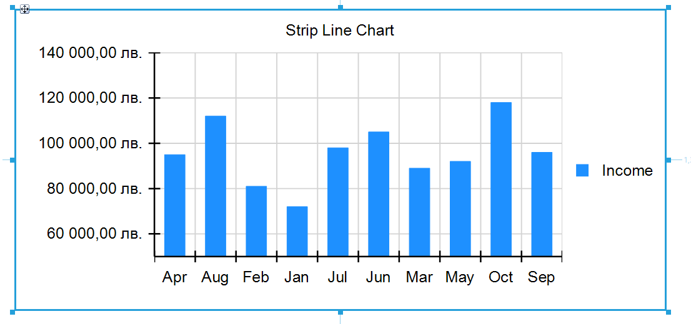
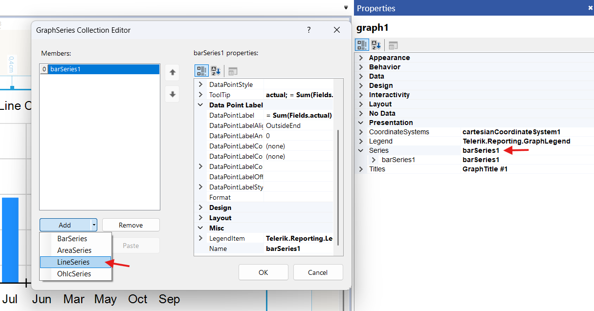
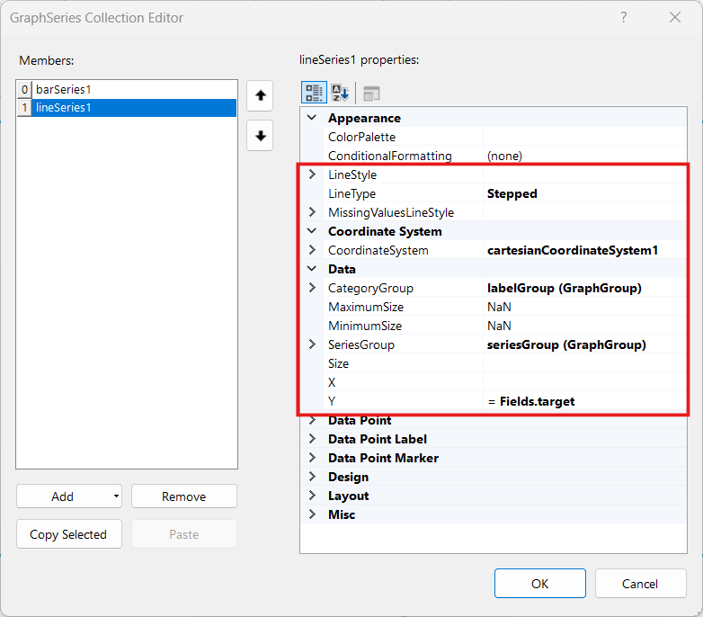
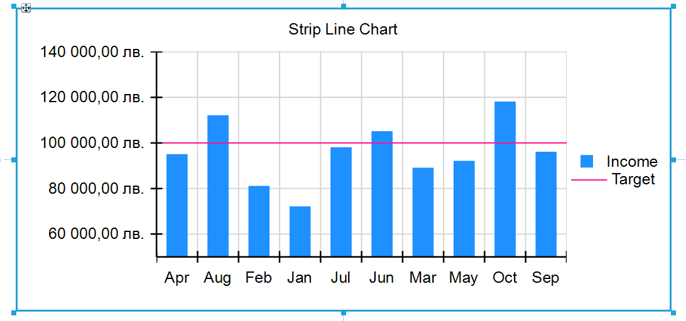

## Environment

The following table lists the product and designer used in this example.

<table>
	<tbody>
		<tr>
			<td>Product</td>
			<td>Progress® Telerik® Reporting</td>
		</tr>
		<tr>
			<td>Designer</td>
			<td>Standalone Report Designer</td>
		</tr>
	</tbody>
</table>

## Description

A strip line chart overlays a horizontal reference line on a chart to show how the plotted values compare with a target or other threshold. In this example, the columns show monthly income, and the strip line marks a fixed target of 100,000.

## Solution

Use the [column and line series approach](slug:telerikreporting/designing-reports/report-structure/graph/how-to/how-to-create-graph-with-column-and-line-series) to add both series to one Graph. Share the coordinate system, category group, and series group so the target line aligns with the income columns and uses the same value scale.

### Creating the Income Columns

Use the following JSON as the inline source for a `JsonDataSource`. Each record contains a month label, the actual income, and the target for that month.

```JSON
[
  { "label": "Jan", "actual": 72000, "target": 100000 },
  { "label": "Feb", "actual": 81000, "target": 100000 },
  { "label": "Mar", "actual": 89000, "target": 100000 },
  { "label": "Apr", "actual": 95000, "target": 100000 },
  { "label": "May", "actual": 92000, "target": 100000 },
  { "label": "Jun", "actual": 105000, "target": 100000 },
  { "label": "Jul", "actual": 98000, "target": 100000 },
  { "label": "Aug", "actual": 112000, "target": 100000 },
  { "label": "Sep", "actual": 96000, "target": 100000 },
  { "label": "Oct", "actual": 118000, "target": 100000 }
]
```

To create the column chart in the Standalone Report Designer:

1. Select **Insert > Column > Clustered Column** to open the Graph Wizard.
1. Select the JSON data source. Drag `label` to **Categories** and `actual` to **Values**. Keep **Sum** as the aggregate and leave **Series** empty.
1. Finish the wizard. The Graph contains one `BarSeries` with `Y` set to `= Sum(Fields.actual)`.
1. Set `LegendItem.Value` on the bar series to `Income`.

The Graph now shows the monthly income columns without the target line.



### Adding the Target Line

To add the target to the same Graph:

1. Select the Graph. In the **Properties** pane, expand **Presentation** and open the `Series` collection editor.
1. In the **GraphSeries Collection Editor**, open the **Add** menu and select **LineSeries**. Keep the line series after the bar series in the collection.

   The **Add** menu lets you add a line series without creating a separate Graph.

   

1. Select the line series and apply the following settings:

   | Property                 | Value                                                                               |
   | ------------------------ | ----------------------------------------------------------------------------------- |
   | `CoordinateSystem`       | Use the bar series coordinate system (`cartesianCoordinateSystem1` in the example). |
   | `CategoryGroup`          | Use the bar series category group (`labelGroup` in the example).                    |
   | `SeriesGroup`            | Use the bar series series group (`seriesGroup` in the example).                     |
   | `Y`                      | Set to `= Fields.target`. Leave `X` unset so the series uses the shared categories. |
   | `LineType`               | Set to `Stepped`. The identical target in each category keeps the line horizontal.  |
   | `LegendItem.Value`       | Set to `Target`.                                                                    |

   The line series uses the same groups and axes as the columns but reads its Y values from `target`.

   

2. Use contrasting colors for the two series. The example uses `DodgerBlue` for the columns and `DeepPink` for the line.
3. Click **OK** and preview the report. Verify that the line marks 100,000 and that the columns for August, June, and October extend above it.

The completed Graph shows the income columns and the target line on the same axis.



Download the [strip line chart sample report (`split-line.trdx`)](https://github.com/telerik/reporting-samples/blob/master/graph-samples/split-line.trdx) from GitHub and open it in the Standalone Report Designer.

## See Also

For more information about Graph configuration, refer to these articles:

* [Create a Graph with Column and Line Series](slug:telerikreporting/designing-reports/report-structure/graph/how-to/how-to-create-graph-with-column-and-line-series)
* [Overview of the Graph Report Item](slug:telerikreporting/designing-reports/report-structure/graph/overview)
