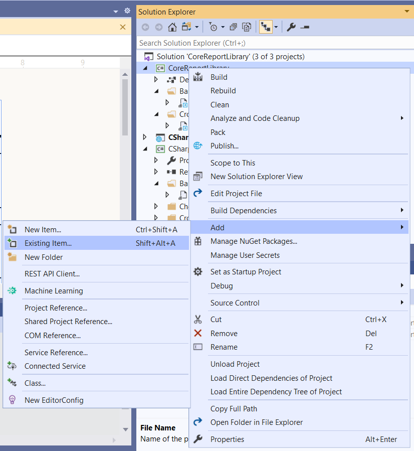
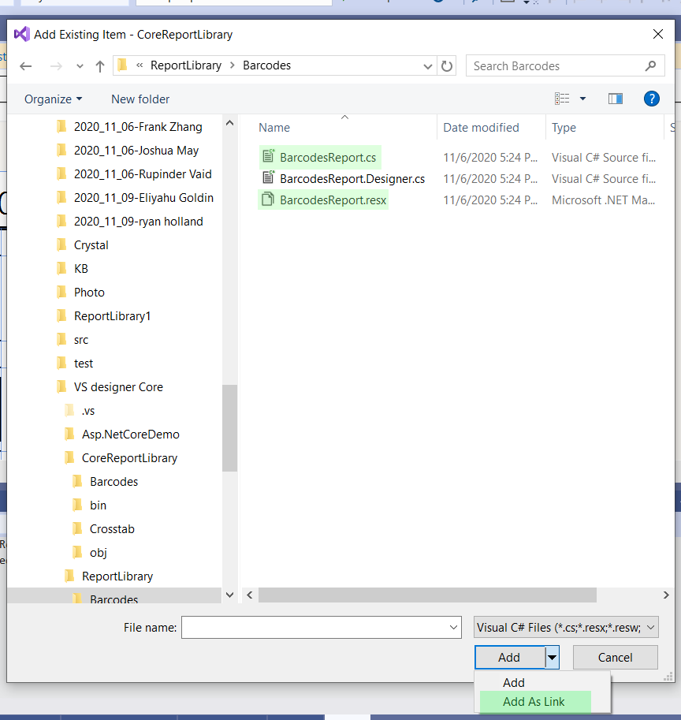

## Environment

<table>
	<tbody>
		<tr>
			<td>Product Version</td>
			<td>13.0.19.116+</td>
		</tr>
		<tr>
			<td>Product</td>
			<td>Progress® Telerik® Reporting</td>
		</tr>
		<tr>
			<td>Target Framework</td>
			<td>.NET</td>
		</tr>
	</tbody>
</table>

## Visual Studio Report Designer for .NET Preview

> important Starting with the Telerik Reporting **2026 Q3 October release (20.2.26.1007)**, the **Visual Studio Report Designer for .NET (VSRD.NET)** is available as a **preview**. You can now edit and preview C# and VB coded reports directly in Visual Studio in supported SDK-style .NET projects, without linking the report files to a .NET Framework project.
>  
> See [Getting Started with the Visual Studio Report Designer for .NET](slug:vs-report-designer-net-getting-started) for prerequisites and setup. The preview requires Visual Studio 2026 version 18.10 or later and a report project targeting `net8.0-windows` or later with `UseWindowsForms=true`.

## Description

The [Visual Studio Report Designer for .NET Framework](slug:telerikreporting/designing-reports/report-designer-tools/desktop-designers/visual-studio-report-designer/overview#installing-the-net-framework-designer) does not support editing reports directly in .NET projects. The Visual Studio Report Designer for .NET preview now supports this scenario for projects that meet its prerequisites.

The following legacy workaround lets you use the .NET Framework designer to edit C# reports hosted in a .NET ClassLibrary project when using an older Telerik Reporting release or an environment that does not meet the preview prerequisites.

## Suggested Workaround

The CSharp code of a report definition is identical in the .NET Framework and .NET. For that reason, it is possible to link the report definition files hosted in a .NET ClassLibrary project to the corresponding files hosted in a .NET Framework ReportLibrary project. This way, all the changes made with the Visual Studio Report Designer to the report in the .NET Framework project will be automatically applied to the .NET project. 

Let's assume that we already have a ReportLibrary project in .NET Framework. Here are the necessary steps to link it to a .NET ClassLibrary project:

1. Create a new .NET ClassLibrary project. You may delete the default CS file usually named `Class1.cs`.
1. Add references to the following assemblies/NuGet packages in the project:

	* `Telerik.Reporting` - defines the needed report definition elements
	* `System.Resources.Extensions` - needed to resolve the resources from the `RESX` file

1. Add the corresponding `CS` report file from the .NET Framework project to the .NET project through the _Add_ -> _Existing Item..._ option of the project context menu.

	

	When selecting the CS file make sure to select __Add As Link__ from the _Add Existing Item_ wizard. The corresponding `DESIGNER.CS` file will be added automatically.

	

1. Add in the same way also the `RESX` file of the report definition.
1. Reference the .NET ClassLibrary project in your .NET project hosting the Telerik Reporting engine. Pass the [AssemblyQualifiedName](https://learn.microsoft.com/en-us/dotnet/api/system.type.assemblyqualifiedname) of the report class to the Reporting engine. Use [TypeReportSourceResolver](/api/Telerik.Reporting.Services.TypeReportSourceResolver) for resolving your reports in a Telerik Reporting REST Service.

A demo solution demonstrating the approach may be found in our GitHub repo - [VS Designer in .NET](https://github.com/telerik/reporting-samples/tree/master/VS%20designer%20Core)

> If you add [SubReport](slug:telerikreporting/designing-reports/report-structure/subreport) or [NavigatToReport Action](slug:telerikreporting/designing-reports/adding-interactivity-to-reports/actions/drillthrough-report-action) to your CLR reports in Visual Studio Report Designer and select [TypeReportSource](/api/telerik.reporting.typereportsource) suggested by the Wizard, it will include a reference to the corresponding .NET Framework ReportLibrary Report Class. You need to make sure the AssemblyQualifiedName is identical when resolved from the .NET ClassLibrary project or correct it manually. Otherwise, you may receive an exception for `Invalid report type`.

## See Also

* [Getting Started with the Visual Studio Report Designer for .NET](slug:vs-report-designer-net-getting-started)
* [Make Visual Studio designer work with .NET](https://feedback.telerik.com/reporting/1383925-make-visual-studio-designer-work-with-net-core-a-k-a-sdk-style-projects)
