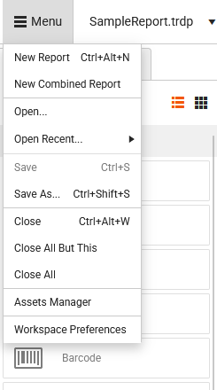
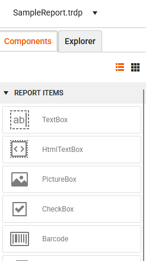

<style>
img[alt$="><"] {
  border: 1px solid lightgrey;
}

</style>

## Environment

| Version | Product | Author | 
| ---- | ---- | ---- | 
| 20.3.26.1110 | Telerik Reporting |[Desislava Yordanova](https://www.telerik.com/blogs/author/desislava-yordanova)| 

## Description

This article shows how to hide the root **Menu** item and its dropdown in Web Report Designer while keeping the other toolbar controls visible.

The following screenshot shows the default **Menu** item and its open dropdown.



## Solution

Add the following `<style>` block to the `<head>` element of your `webReportDesigner.html` host page:

```html .skip-repl
<style>
  li.main-menu__item.root-menu {
    display: none !important;
  }
</style>
```

Reload the host page. The root **Menu** item and its nested dropdown are hidden, while the other toolbar items remain visible.



## Notes

This CSS changes the rendered interface only. It does not change server-side authorization. To hide selected commands instead of the entire menu, use `DeniedPermissions`.

The selector targets CSS classes in the Web Report Designer markup. Verify it after you upgrade Telerik Reporting because the markup can change.

## See Also

* [Customizing individual Web Report Designer commands]()
