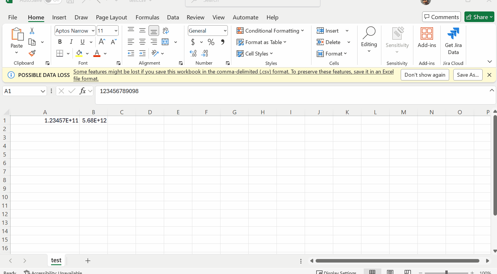

## Environment

<table>
<tbody>
<tr>
<td> Product </td>
<td>
Reporting
</td>
</tr>
</tbody>
</table>

## Description

When exporting reports to CSV in Telerik Reporting, large numeric values may display in scientific notation (e.g., `2.61001E+11` instead of `261001003930`) upon opening the CSV files in Excel. This behavior occurs because Microsoft Excel automatically formats large numbers in scientific notation when opening CSV files. The issue persists even when trying formatting expressions such as `{0:N2}` or converting numeric values to strings.

While exporting to XLSX lets us pass the formatting, for example '{0:N2}', the CSV file is a plain text file format, and we cannot pass the number formatting.

This knowledge base article also answers the following questions:
- How to prevent Excel from converting numbers to scientific notation in CSV exports?
- How to display large numeric values correctly in CSV exports?

## Solution

To prevent scientific notation in CSV exports and correctly display large numbers, use any of the approaches below:

1. **Modify Excel Import Settings**:  
   When opening the CSV file in Excel, disable automatic data type detection:
   - Open a blank workbook in Excel.
   - Go to the **Data** tab and click **From Text/CSV** (or **Get Data > From File > From Text/CSV**).
   - Select the CSV file and click **Import**.
   - In the import window, set the data type detection to **Do not detect data types** (or manually select **Text** for columns that need to preserve specific formatting).
   - Click **Load**.

1. **Export to XLSX Instead of CSV**:  
   Export the report to XLSX format instead of CSV. XLSX supports formatting, and you can directly use expressions like `{0:N2}` to control the number format.

1. **Manually Format Cells in Excel**:  
   If you already opened the CSV and see scientific notation, change the cell format to **Number**:
   - Select the column or cells containing the numbers.
   - Right-click and choose **Format Cells** or select it from the **Cells > Format** area in the menu.
   - Choose **Number** and specify the desired number of decimal places.

   

## See Also

- [Design Considerations for the CSV Rendering](slug:telerikreporting/designing-reports/rendering-and-paging/design-considerations-for-report-rendering/csv-rendering-design-considerations)
- [Adjusting Currency Formatting for CSV Export](slug:adjusting-currency-formatting-csv-export-reporting)
