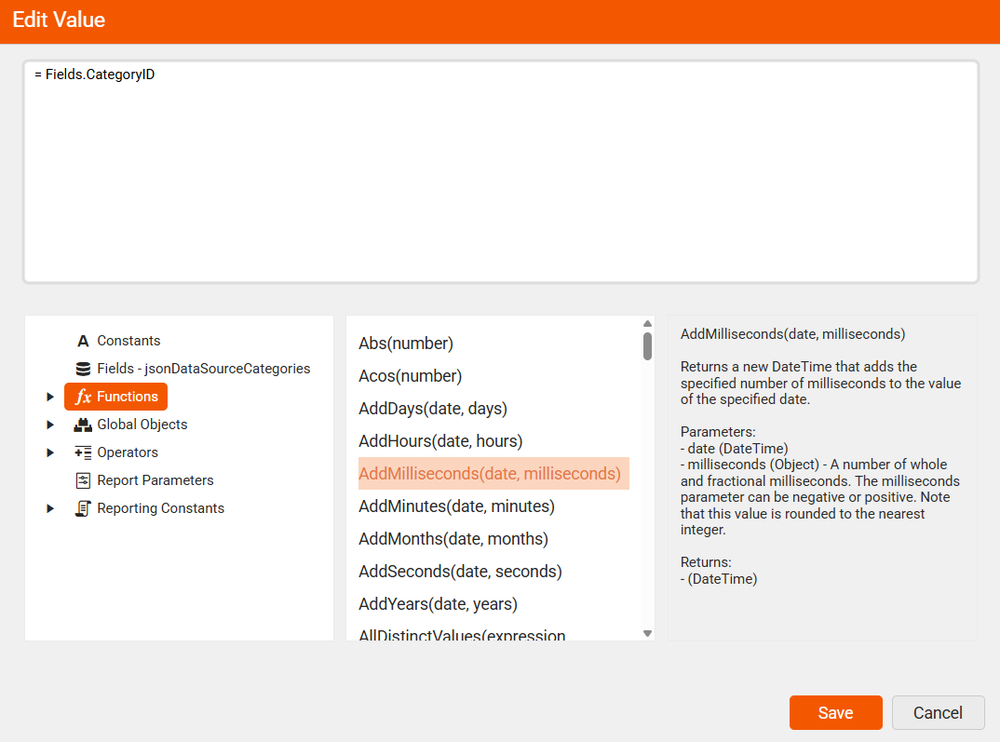

<style>
img[src$="CreatingExpressionEditorWRD.png"] {
  border: 1px solid lightgrey;
}
</style>

# Customize Report Behavior Using the Expression Editor

Instead of manually entering fixed values, you can use expressions to make your report items smarter and more dynamic. This means your reports can automatically adapt to changing data or conditions—saving you time and reducing errors. The expression editor helps you build these expressions easily, offering ready-to-use elements and clear descriptions so you can focus on getting the result you need without digging through documentation.

## Open the Expression Editor

1. Select the report item whose value you want to calculate, such as a TextBox.
1. Locate its **Value** property in the **Properties Area**.
1. Select the ellipsis (**...**) button next to **Value**. The **Edit Value** dialog opens.



## Designing Expressions with Built-in Elements

By using the predefined expression components in the Web Report Designers, you can build flexible expressions with minimal effort, eliminating the need for coding or manual calculations. The available built-in elements are:

| Name | Description |
| ------ | ------ |
| `Constants` | Use fixed values like numbers, text, dates, and booleans to ensure consistent logic and formatting that stays unchanged during report execution |
| `Fields – mainDataSource` | Represent the actual data columns from your connected data source |
| `Functions` | Predefined formulas that perform calculations or logic using values like fields, constants, or other functions to create dynamic expressions |
| `Global Objects` | Built-in objects that provide access to report-wide information such as current user identity, execution time, page numbers, rendering format, and environment details |
| `Operators` | Symbols used in expressions to perform calculations, comparisons, logic, or string operations—like '+', '=', 'AND', or 'LIKE'. |
| `Report Parameters` | Report-level inputs that control report content, filtering, or layout—often used to pass values, filter data, or link related reports |
| `Reporting Constants` | Predefined values used to control report layout and styling—such as alignment, borders, image sizing, and page behavior |

To build an expression with the built-in elements in **Edit Value**:

1. Select **Fields** for the connected data source and choose the field to use. For the screenshot's example, use a data source containing `CategoryID` and enter `= Fields.CategoryID` in the expression area.
1. To extend the expression, browse **Functions**, **Operators**, or the other built-in categories. Select an element to read its description, parameters, and return type, then use it in your expression.
1. Select **Save** to apply the expression.
1. Preview the report to check the calculated value. For `= Fields.CategoryID`, the TextBox displays the category identifier for the current data row.

The following video also demonstrates building expressions with the built-in elements:

<iframe width="560" height="315" src="https://www.youtube.com/embed/V9pPYD3nDT0?si=vjX_Zj4WrJqT--34" title="Building expressions with built-in elements in the Web Report Designer" frameborder="0" allow="accelerometer; autoplay; clipboard-write; encrypted-media; gyroscope; picture-in-picture; web-share" referrerpolicy="strict-origin-when-cross-origin" allowfullscreen></iframe>

>tip You can add a new line as a string in the Expression with the `Edit Expression` dialog.
>
>```Expression
>= Fields.FirstLine + "
>" + Fields.SecondLine
>```
>
>The result will be the values of the two fields being displayed one above the other in the corresponding report item.

## Embedded Expressions

Embedded expressions allow you to mix **static text** and **dynamic values** (expressions) inside the same string property. They are used when you want a textbox, HTML textbox, parameter label, or other string-capable property to display text that includes field values, parameter values, or expression results.

An embedded expression is written by enclosing the expression in **curly braces { }** inside a string literal:

`Hi Mr. {Fields.LastName}, {Fields.FirstName}!`

At run-time, the reporting engine evaluates the expressions and constructs a final string:

`Hi Mr. Smith, John!`

>note If you need literal **{** or **}**, you must escape them with double braces: **\{\{** or **\}\}**.

## See Also

* [Functions Overview](slug:telerikreporting/designing-reports/connecting-to-data/expressions/expressions-reference/functions/overview)
* [Data Sources](slug:web-report-designer-user-guide-components-data-sources)
* [Approaches for Adding Report Parameters](slug:telerikreporting/designing-reports/connecting-to-data/report-parameters/how-to-add-report-parameters#web-report-designer)
* [Aggregate Functions Overview](slug:telerikreporting/designing-reports/connecting-to-data/expressions/expressions-reference/functions/aggregate-functions)
