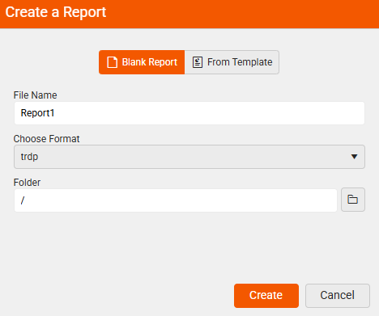
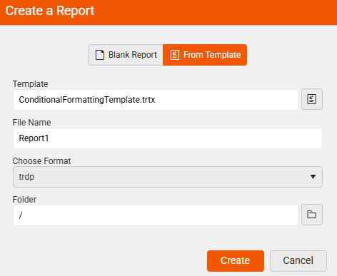
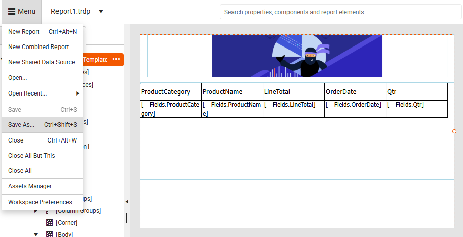
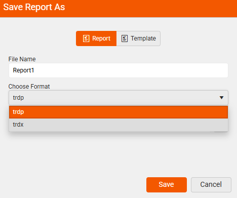
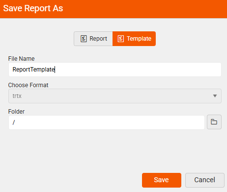
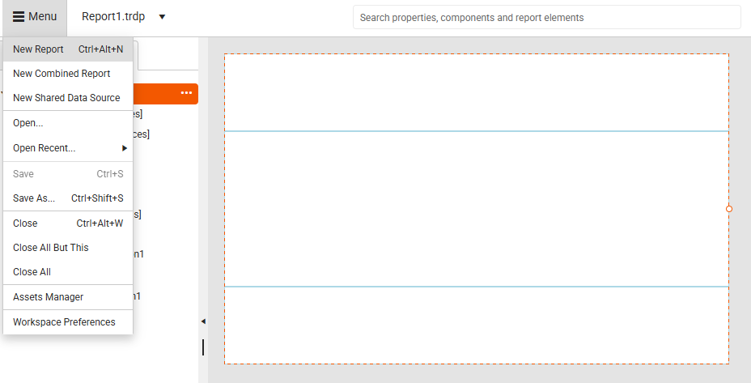
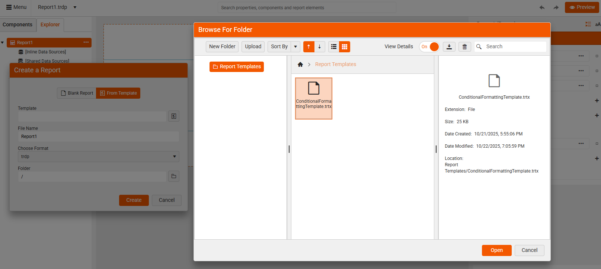
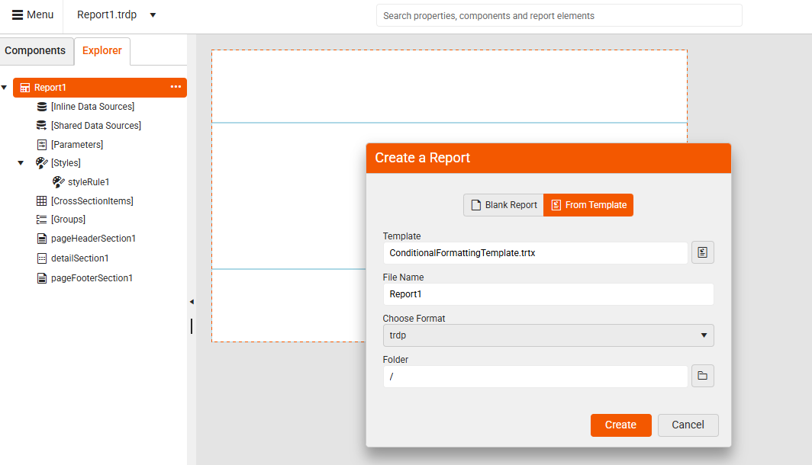

# Creating and Using Report Templates

A **report template** is a reusable design that defines the layout, styling, and data structure of a report. It allows report designers to create consistent and professional-looking reports without starting from scratch each time.

|Minimum Version:|Q4 2025|
|----|----|

## Key Benefits

Whether you are building dashboards, invoices, or summaries, report templates help you start with a solid foundation, save time, and ensure visual and structural consistency across your reporting projects. Using templates offers:

* **Increased Productivity:** Templates offer a ready-made layout and structure, so you can focus on your data instead of design.

* **Consistency:** Maintain a uniform look and feel across multiple reports, especially useful for teams or organizations.

* **Simplified Design for Non-Designers:** Even if you are not familiar with styling or layout best practices, templates give you a polished starting point.

* **Customization and Reuse:** Adapt templates to fit different projects or departments, and reuse them to stay efficient.

* **Branding Support:** Include your company's logo, colors, and fonts to ensure every report aligns with your brand identity.

## Working with Report Templates

When you create a new report by selecting **New Report** in the main menu, you can choose between two options:

  * Beginning from scratch with a **Blank Report** - Gives you an empty report.
  * Starting **From Template** (`.trtx` file) - Gives you a ready-made layout and structure to build on, making report creation faster and more consistent.
    
The following screenshots show both options:

|Create a Blank Report|Create From a Template|
|----|----|
| ||  

### Creating Report Templates

To create a report template, follow these steps:

1. Create a blank report by selecting the **Blank Report** option.

1. Design the report in the Web Report Designer according to your needs.

1. Save the report as a template. This allows you or your team to reuse it for future reports.

    To save the currently open report, select **Save As...** from the menu:

      

    The designer presents the option to save the report as a **Report** (`.trdp` or `.trdx` file format) or a **Template** (`.trtx` file format).

    Select the **Template** option:

    |Save As Report|Save As Template|
    |----|----|
    | || 

### Using Report Templates

To start a report from a predefined template with a ready-to-use design, follow these steps:

1. Select **New Report** from the **Menu**:

	   

1. Create a report from an existing template by selecting the **From Template** option.

1. Navigate to the existing template (`.trtx`) file. When you create a new report, you can choose a template from the available list. The designer loads the layout and styles, and you can then customize the content and data bindings.
	
	 

1. Enter a file name and select the format for your new report:

	 

Continue customizing the report that the designer loaded from the template.

>note Some users might not see the Report Templates options if they don't have such permissions (configured by the app developer).

## See Also

* [How to Edit a Report Template](slug:web-report-designer-how-to-edit-a-report-template)
